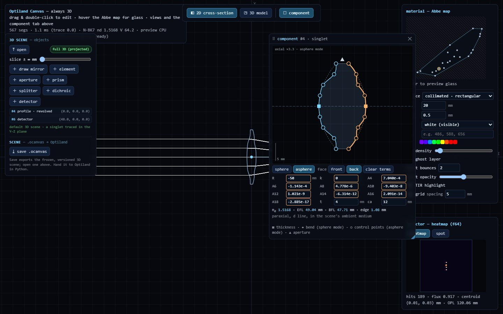
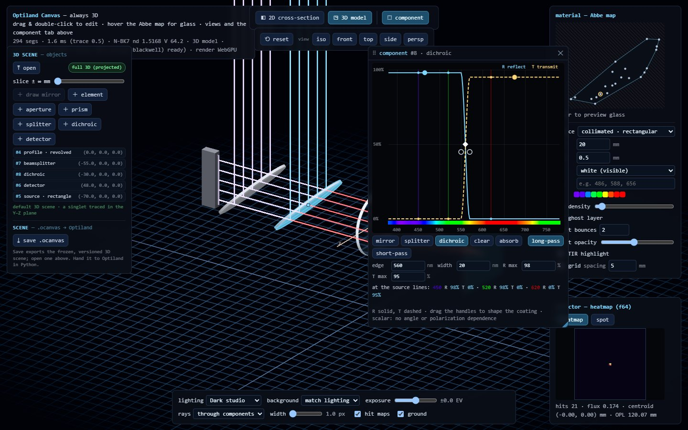

# The component view, beam splitters, and dichroic filters

This branch (`component-view-splitters`, on top of `3d-solid-renderer`) adds three things:

- **The component view:** a tab in the top bar that opens the selected element in its own window over the canvas. On a singlet, the window has handles for the faces, the thickness, the aperture and the aspheric terms.
- **Beam splitters and dichroic filters:** plates you can add from the scene dock. They divide each ray into a reflected and a transmitted branch, weighted per wavelength.
- **A fix to the interactive preview:** while an element is dragged, the preview now shows the folded arm of a splitter and shows dichroics at all.

No file format changed. Aspheric faces and tabulated reflectance and transmittance were already part of `.ocanvas` v2; this branch adds the authoring for them.

## The component window

- **Opening it:**
  - Click `⬚ component` in the top bar to open the window where it was last, or in its default place left of the right-hand panels.
  - Drag the tab onto the canvas and let go: a dashed outline follows the pointer, and the window opens where it is dropped.
  - A drop on the top bar does nothing.
- **Moving and closing it:**
  - Drag the header to move the window, and the corner to resize it.
  - The ✕ closes it, and so does dragging the header back onto the top bar: the tab lights up while the drop would close it.
- **Remembered:** the window's place, size, and whether it is open are saved in the browser (`optiland-canvas:inset`), as is the lens editor's mode (`optiland-canvas:lens-editor-mode`).
- **What it shows:** the selection of whichever view owns the canvas, 2D cross-section or 3D model. It re-reads the element whenever the scene revision moves, so an edit made anywhere shows in the window, and an edit made in the window shows everywhere.
- **During an edit:** while a handle is held, the view that owns the canvas draws the fast f32 picture. When the handle is let go, it settles on the exact f64 trace and the detector readout updates.

| Selection | What the window shows |
|---|---|
| A singlet | Its profile, with handles and fields (the lens editor) |
| A flat surface: mirror, splitter, dichroic, clear plate, absorber | Its reflectance and transmittance across the visible band, with handles (the coating editor) |
| An aperture | The mask face on, with rings for the opening and a central stop |
| A detector | Its face to scale: shape, size and pixel counts, with the pitch and the rays behind each pixel. What it measures, and the picture that measure makes: the pixels for power and irradiance, and for intensity the far field on a grid of two angles or as a polar map. Beside it, cross-sections along lines you drag across the picture, or each wavelength's direction, position, spot and focus, and a choice of how many times the ray density's rays the numbers are traced with. It quotes the flux on the face that the detector dock quotes, from the same trace. See [what a detector measures](detectors.md). |
| A light source (3D view only) | Its spectral lines |
| A prism or another body | A summary: kind, position, glass |

## The lens editor

The profile is drawn in the lens's own frame: optical axis to the right, light entering the front face. A lens is much taller than it is thick, so the axial direction is stretched, up to 6×, and labelled (`axial ×3.6`). The front face is drawn cyan and the back face orange. When a face has aspheric terms, its base conic is drawn dashed behind it. `F′` marks the paraxial back focus when it falls inside the drawing.

| Handle | Drag | Effect |
|---|---|---|
| ■ on a face's vertex | sideways | Changes the centre thickness. The other face keeps its place in the scene: the body moves by half the change along its axis. |
| ● on a face's rim (sphere mode) | sideways | Bends the face. The radius is solved from where the rim is put; the conic constant and the aspheric terms stay. |
| ▲ above the rim line | up or down | Changes the clear semi-aperture. |
| ○ control points (asphere mode) | sideways | Four per face, at 1/4, 1/2, 3/4 and all of the semi-aperture. Dragging one reshapes the face through all four (see below). |

The fields under the drawing set the selected face's R (empty or `∞` is flat), conic k, and A4 to A18, plus the thickness and the semi-aperture. The mouse wheel scrubs a field. `clear terms` removes the selected face's aspheric terms. The readout gives n_d, the paraxial EFL and BFL at the d line in the scene's ambient medium, and the edge thickness, all computed in Rust.

Every edit goes through a Rust setter that refuses an invalid shape and leaves the scene as it was, and the window says so in orange. Refused shapes:

- faces that cross;
- a bend past the conic's reach (past a hemisphere, for a sphere);
- a centre thickness or semi-aperture that is not a positive number;
- a NaN radius. An infinite radius is a flat face.

### How the handles map to the surface

- **Bend:** the rim sag `s` asked for, minus the aspheric terms' share at the rim, gives the curvature `c = 2s / (h² + (1+k)s²)` at the semi-aperture `h`. This inverts the conic sag while `(1+k)s² ≤ h²`; beyond that the edit is refused. A zero conic share makes the base flat.
- **Control points:** the face keeps its curvature and conic. Its eight terms A4 to A18 become the set that passes through all four points and bends least doing so: with `u` the height over the semi-aperture and `d(u)` the departure from the conic, the fit minimises `∫₀¹ d''(u)² du` subject to `d(u_i) = s_i − conic(h_i)`.
  - It is solved as one linear system (the minimisation and the four constraints together).
  - A fit that misses a point by more than 1e-9 of its sag is refused, as are two points at one height.
- **Why least bending:** a fit with only as many terms as points also passes through the points, but it swings far between them. With a unit move of one control point and the others held:

| Point moved | Largest departure, 4 terms | Largest departure, least bending |
|---|---:|---:|
| 3/4 of the aperture | 2.42 | 1.01 |
| 1/2 of the aperture | 8.95 | 1.04 |
| the rim | 1.00 | 1.00 |

- **Storage:** a face whose terms are all zero is stored as a plain `Conic`, and as an `EvenAsphere` otherwise. A conic singlet's document, and its planar reduction, are unchanged by this branch.
- **The card:** its `setSingletGeom` now keeps a face's aspheric terms instead of dropping them.

## Beam splitters and dichroic filters

`＋ splitter` and `＋ dichroic` in the scene dock add a round plate, radius 15 mm, at x = −35 mm, tilted 135°. There the default beam meets the plate's front face, and the reflected arm goes up (+Y).

### The model

Both are zero-thickness surfaces with `SurfaceResponse::ExplicitRt` on both faces. The model is two numbers: nothing depends on the angle of incidence, and two numbers cannot describe a polarization interaction either, so the reference tracer treats such a surface as an ideal phase-neutral attenuator and records that assumption when the light reaching it is already polarized ([`polarization.md`](polarization.md)). The plate has no substrate, so there is no refraction through it and no back-surface reflection.

- **Beam splitter:** constant reflectance R and transmittance T, with `R + T ≤ 1`; the rest is absorbed. The default is 50:50.
- **Dichroic (`DichroicSpec`):**
  - A long-pass coating transmits wavelengths above its edge and reflects those below; a short-pass coating does the opposite.
  - The transition is a raised cosine `width_nm` wide, tabulated at 9 wavelengths and held flat beyond them (`OutOfRangePolicy::Clamp`).
  - Reflectance falls from `r_max` to 0 while transmittance rises from 0 to `t_max`. Both tables share one grid, so `R + T ≤ max(r_max, t_max)` everywhere.
  - Defaults: edge 550 nm, width 20 nm, R 0.98, T 0.95.
  - `DichroicSpec::from_response` recovers the parameters only from tables that `response()` made. Any other table reads as a generic coated face (`coated`), not as a guessed dichroic.

The f64 tracer already split `ExplicitRt` into two primary branches. The trace tests (`crates/oc-trace/tests/splitters3.rs`) fold the default beam and check where the flux lands:

- A 30:70 splitter sends exactly 30 % up.
- A long-pass dichroic sends 98 % of the 450 nm line up, and only the 650 nm line reaches the lens focus.
- Short-pass swaps the two.
- A line in the middle of the transition splits 0.49 / 0.475.
- The energy ledger balances to 1e-12.

### The drag-time preview

The f32 preview (the CPU mirror and the WebGPU shader) had two gaps, fixed in `oc-gpu`:

- **The fold was treated as a ghost.** The reflected branch of `ExplicitRt` was traced only with ghosts on, and flagged as a ghost. With ghosts off, a splitter's folded arm vanished while dragging. It is now a primary branch, as in the f64 tracer.
- **Tabulated responses were refused.** `GpuScene3::build` refused a tabulated reflectance or transmittance, and the preview then left the whole surface out, so a dichroic disappeared while dragging. The preview now samples the tables per ray wavelength with the same interpolation and out-of-range rules as the f64 tracer. The shader reads them from the vertex arena.
  - `Surface3Buf` grows from 128 to 224 bytes.
  - A new test validates `shader3.wgsl` with naga and checks every uploaded struct's layout against the Rust side, with no GPU device.

### Display

- **3D view:**
  - A splitter is a half-silvered plate. Its metallic share follows R.
  - A dichroic is clear glass tinted by the colour it passes, glowing faintly in the colour it reflects.
  - The colours come from Rust (`render_view.rs`): the face's R and T tables weighted across 380 to 780 nm with the rays' wavelength colours. A colour here stands for a real spectral curve.
  - The colours are shader uniforms, quantized, so every coated plate of a kind shares one shader.
- **2D cross-section:** a splitter is drawn dashed, and a dichroic in the colour its front face reflects.
- **Coating editor:**
  - It plots R (solid) and T (dashed) from `surfaceRtF64`, the tables the tracer reads, over the visible band.
  - The source's wavelengths are marked, and the readout lists each line's R and T.
  - Handles: R and T levels for a splitter, which keep the absorbed share when dragged; the edge, the two ends of the transition, and the two plateaus for a dichroic.
  - Kind buttons (mirror, splitter, dichroic, clear, absorb) and the fields apply to both faces.
- **Cards:** the per-face selects in the inspector card gain `split 50:50` and `dichroic`.

### Optiland export

The Optiland bridge builds a sequential `Optic`, and a split beam has no sequential form, so splitters and dichroics are not exported. Aspheric singlets export as Optiland even aspheres, as before.

## Removed: the Canvas 2D wireframe 3D view

The last commit on `3d-solid-renderer` removes the old wireframe view (`viewport3d.ts`, `?renderer=legacy`) and the wasm method only it used (`bodyExtrudeJSON`). A browser with neither WebGPU nor WebGL2 now gets a notice in the 3D view; the 2D cross-section still works there.

## New `Canvas` methods (wasm)

| Method | What it does |
|---|---|
| `singletShapeJSON(id, samples)` | Radii, conics, thickness, semi-aperture, both faces' terms, paraxial n_d, EFL and BFL, edge thickness, and each face's meridian |
| `singletFaceSagF64(id, back, heights, conicOnly)` | A face's sag at the given heights, or its base conic's |
| `setSingletShape(id, r1, r2, t, ca, k1, k2, asph1, asph2)` | The whole shape in one edit |
| `bendSingletFace(id, back, rimSag)` | The bend handle |
| `fitSingletFace(id, back, heights, sags)` | The control points |
| `addBeamSplitter(x, y, radius, tilt, r, t)` / `setSurfaceSplit(id, r, t)` | Splitters |
| `addDichroic(x, y, radius, tilt, edge, width, longPass)` / `setSurfaceDichroic(id, edge, width, longPass, rMax, tMax)` | Dichroics |
| `surfaceCoatingJSON(id)` | Each face's kind, constant R and T, and dichroic parameters |
| `surfaceRtF64(id, back, nm)` | R and T at each wavelength, from the tables the tracer reads |

`sceneObjectsJSON` names surfaces `beamsplitter` and `dichroic`, and `surfaceResponseJSON` reports `split`, `dichroic` and `coated`. `renderObjectsJSON` gains the display roles `beamsplitter` and `dichroic` and a `coat` field. `sceneCrossSectionJSON` gains the kinds `splitter` and `dichroic`, and a `tint`.

## Validation

All run locally on Windows 11 with an RTX 5070 and Chrome 153, with every job in `ci.yml` mirrored.

- **Rust, new tests:**
  - `build3`: 9 tests. Aspheric terms round-trip and survive geometry edits; a fitted face passes through its points and stays between them; bends land where asked; inside-out and crossing shapes are refused; the paraxial focal lengths match a ray-transfer matrix; splitters and dichroics validate, round-trip and refuse bad values; the dichroic tables are complementary.
  - `render_view`: 1 test for the coating colours and material revisions.
  - `Canvas`: 2 tests for the new bindings.
  - `oc-trace`'s `splitters3`: 4 tests.
  - `oc-gpu`: the parallel work added 6 parity tests against the f64 tracer, 2 shader layout tests, unit tests for the table sampling, and 2 GPU parity scenes.
- **Rust, suites:**
  - `cargo test --workspace --exclude oc-py`: 609 passed, 9 failed, 3 ignored. All 9 failures are `gpu3_vs_cpu3`: this machine's DirectX 12 shader compiler rejects that pipeline, as it did for the 7 older tests on `main`. The 2 new GPU scenes are the other two, and they pass on the same machine with `WGPU_BACKEND=vulkan` and `WGPU_BACKEND=gl`.
  - `oc-core --features scene3`: 252 passed.
  - `oc-trace --features trace3`: 89 passed, 1 ignored.
  - Clippy with `-D warnings` is clean on all four CI steps, `oc-py` included.
- **Python bridge:** the CI job (install, then `pytest` against Optiland): 38 passed.
- **Browser, CI project:**
  - The full suite passes: 64 tests.
  - `tests/component.spec.ts` (5 tests) covers:
    - the tab: click, drop placement, reload, and closing by dropping the header on the bar;
    - the lens handles: bend, thickness with the back face held in place, a refused thickness, a control point that moves only its own height and changes the trace, the fields, and `clear terms`;
    - a splitter, whose folded arm stays in the fast picture while a handle is held, and whose flux follows the handle and the field to the f64 readout;
    - a dichroic, whose folded flux matches its tables for the F, d and C lines before and after an edge drag and after switching to short-pass;
    - the inset following the 3D view and editing there.
- **Browser, opt-in:**
  - `OC_WEBGPU=1 … --project=webgpu`: 21 passed on Chrome's WebGPU. A new test compares the GPU picture with the CPU mirror through a splitter and a dichroic at four wavelengths.
  - `OC_VISUAL=1 … --project=visual`: 13 screenshots, all passing. A new one shows a splitter and a dichroic folding the beam. All were re-recorded, because the top bar gained the tab.

## Found and not fixed

The `oc-gpu` work turned up differences between the f32 preview and the f64 tracer that predate this branch and are outside it:

- **Ghost limit:** the f64 tracer raises a branch's ghost depth only on its first ghost, so `max_ghost_bounces` limits nothing unless it is 0. The preview counts every Fresnel ghost, so ghost trees can differ once that limit is reached.
- **AR residual on bodies:** the preview ignores a glass body's `ar_residual`, which the f64 tracer applies.
- **Depth cap:** the preview drops a branch at `depth >= max_depth`, the f64 tracer at `depth > max_depth`.
- **Rounding at a table's end:** a wavelength within one f32 step of a table's end can count as inside the table in f32 and outside it in f64.

## Limitations

- **One window:** the component window shows one element, the selection. There is no undo for edits to the 3D scene, here or anywhere else in the app.
- **Control points:** there are four per face, at fixed fractions of the semi-aperture.
- **Paraxial numbers:** they are for the lens alone, on its own axis, at the d line.
- **Coatings:** the `film` kind is a real thin-film stack and depends on the angle of incidence; every other kind is scalar and does not. All are zero-thickness and applied to both faces by the kind buttons. A mirror's reflectivity is shown but not editable in the window. See [coatings](coatings.md).
- **Detector view:** it is a picture of the last exact trace, and it re-reads whenever the dock does. The measure, the face and the pixel counts are the detector's own, stored in the scene rather than settings of the window. While a size handle is held the face is drawn empty, because its numbers belong to the release. The far field has no face handles, so an intensity detector is resized from the fields. A cross-section samples whole rows or columns of cells; it does not interpolate between them.
- **Source view:** it shows spectral lines only for the first source, the one the source panel edits.
- **Other bodies:** prisms and analytic solids get a summary, not an editor.

## Screenshots

| | |
|---|---|
| Lens editor, sphere mode | [lens-sphere.jpg](component-view/lens-sphere.jpg) |
| Lens editor, asphere mode, a face reshaped | [lens-asphere.jpg](component-view/lens-asphere.jpg) |
| Dichroic coating editor with the F, d, C lines | [dichroic.jpg](component-view/dichroic.jpg) |
| Beam splitter coating editor | [splitter.jpg](component-view/splitter.jpg) |
| A splitter and a dichroic in the 3D view | [splitter-dichroic-3d.jpg](component-view/splitter-dichroic-3d.jpg) |
| Carrying the tab onto the canvas | [drag-out.jpg](component-view/drag-out.jpg) |
